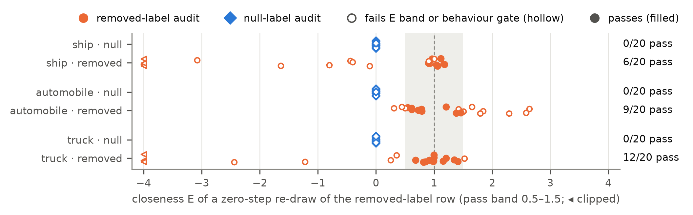
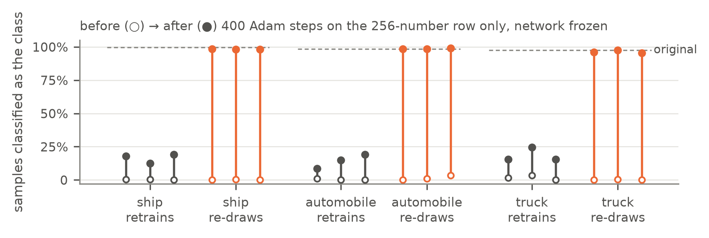

# The retrain never saw the label

**An ill-posed reference in class-unlearning audits of conditional diffusion models.**

Paper (4-page workshop version plus appendix): [`paper/workshop/main.pdf`](paper/workshop/main.pdf) · long draft: [`paper/DRAFT.md`](paper/DRAFT.md) · every registration and outcome: [`PREREGISTRATION.md`](PREREGISTRATION.md)

## The finding in one paragraph

Class unlearning in a conditional diffusion model is judged against an **exact retrain**, a model trained from scratch without the forgotten class, and often by comparing the two *under the forgotten label*. But the retrain never saw that label. When the label enters through a learned embedding (as in DiT, ADM and EDM code), the forgotten label's embedding row gets **exactly zero gradient** and stays at its random initialisation. The retrain's "behaviour on the forgotten class" is therefore each network's reading of an untrained, seed-specific random input, and different retrains disagree. We show on a CIFAR-10 class-conditional DDPM, mostly with pre-registered studies, that this makes the standard reference unreliable. A zero-step edit passes the audit, and the published FID_O metric inherits the problem. Querying the **null (classifier-free-guidance) label**, which every model trains, gives a calibrated alternative.

## Key results

| Claim | Evidence | Status |
|---|---|---|
| The removed label's row is untrained in every retrain | 12/12 retrains: row moved ≤ 3.4·10⁻⁶ from init (float32 round-off), against ≈ 0.97 for trained rows | measured |
| The removed-label reference does not recognise a held-out retrain | leave-one-out closeness E undefined in 7/12 rotations, otherwise −2.1 to 2.2 where 1 is expected; fails on every class | pre-registered (ship, truck) |
| Sharing one row across retrains does not fix it | all three C4-R predictions **failed**; we withdrew our "independent draws" explanation | pre-registered, failed |
| The null-label reference is calibrated | held-out retrains score 0.94–1.13 (9/9 inside [0.8, 1.2]) on the 3 classes with enough signal; retrains that removed a *different* class score < 0.2 | pre-registered (C2, C3-B, C4-X); one homogeneity rule failed |
| A zero-step edit passes the removed-label audit | re-drawing only the forgotten row passes 6/20, 9/20, 12/20 (ship, automobile, truck), at a rate similar to genuine held-out retrains (3/9, post hoc) | pre-registered (C3-A) |
| …although the class is still there | re-fitting that one row restores the class to ≥ 95.5 % of samples, against ≤ 24.5 % for retrains | exploratory |
| Published FID_O inherits it | FID_O (Zheng, Tai & Yeh, CVPR 2026) is reported as 0.00 for the retrain. Two exact retrains differ by 2.1–4.3× the sampling floor, inflated 1.3–3.0× by the forgotten label; on 2 of 3 classes the *unmodified* model is no farther from some retrain than retrains are from each other | pre-registered (C5); sanity rule O3 **failed**, held on truck only |

Failed predictions are reported as findings; see [`PREREGISTRATION.md`](PREREGISTRATION.md) for every rule, timestamp and outcome.

<p align="center"><br></p>

## What it means for practice

1. Do not use the retrain's forgotten-label pathway as a reference. If you report one, add the retrain-to-retrain spread, a leave-one-retrain-out check, and zero-step re-draws as a negative control.
2. For FID_O, report the value between independent retrains alongside method values, not 0.
3. Where the model trains a null token (DiT by default; EDM only with label dropout; not ADM), audit the unconditional pathway against several retrains.
4. The mechanism applies to learned input-side label embeddings under Adam(W). Frozen text encoders (e.g. Stable Diffusion) and classifier output heads are outside it.

## Limitations

- One 6.48M-parameter U-Net on CIFAR-10 and three retrains per class.
- DiT, ADM and EDM were checked at the code level only; we did not train them.
- The null-label audit is shown to be specific, not sensitive.
- C5 used 1,000 samples per label (the published protocol uses 5,000), so our FID_O values are not numerically comparable with published ones.

Full list: paper appendix C.

## Next step

Test the finding on a second architecture, a small **DiT** (plus an EDM-style label input), under rules registered before data. The design is in [`docs/next-step-second-architecture.md`](docs/next-step-second-architecture.md). It needs roughly **100–150 T4 GPU-hours** of retraining, beyond our current free quota.

## Repository map

| Path | What it is |
|---|---|
| [`paper/workshop/`](paper/workshop/) | LaTeX source and PDF (`cd paper/workshop && tectonic main.tex`) |
| [`paper/DRAFT.md`](paper/DRAFT.md) | Long draft with full tables |
| [`paper/RESEARCH_JOURNAL.md`](paper/RESEARCH_JOURNAL.md) | Research argument and process log, including the path from the original hypotheses to this finding (§7) |
| [`PREREGISTRATION.md`](PREREGISTRATION.md) | Every registered study (C1–C5) with timestamps relative to data, amendments, and scored outcomes |
| [`EXPERIMENT_LOG.md`](EXPERIMENT_LOG.md) | Append-only run log: config, expectation before launch, observation |
| [`src/`](src/README.md) | Code: `diffusion/` (model, training, sampling, unlearning methods), `analysis/` (one module per study), `audit/` (MIA, attribution, probe, relearning, spectrum) |
| [`results/figures/`](results/figures/) | JSON outputs of every analysis the paper cites (checkpoints are not in the repo) |
| [`tests/`](tests/) | `python3 -I tests/test_audit_cores.py`: 29 numpy-only tests, including every registered scoring rule |
| [`docs/history/`](docs/history/) | The original proposal (influence + membership inference, diffusion and LLM tracks), its independent review, reading list and roadmap |
| `notebooks/`, `src/llm/`, `configs/llm_*` | Original plan's Kaggle notebooks and LLM track. **The LLM track was not run at scale** and makes no claim here. |

## Reproducing

```bash
pip install -r requirements.txt
python3 -I tests/test_audit_cores.py            # scoring rules, no GPU

# Models (≈ 3.2 T4 GPU-h per 40k-step training; base + 12 retrains)
python -m src.pipeline classifier base
UA_ORACLE_JOBS=8:0,8:1,8:2 python -m src.pipeline oracle_confirm   # retrains without ship; likewise 1:*, 3:*, 9:*

# Analyses (each module's docstring names its registered study)
python -m src.analysis.label_diag results 8      # removed- vs null-label calibration
python -m src.analysis.c3_consequence results 8 1 9
python -m src.analysis.c3_knowledge results 8
python -m src.analysis.c4_controls results
python -m src.analysis.c4_fd results 1000 8 1 9
python -m src.analysis.c5_fido results 1000      # ≈ 13 h on an Apple M-series laptop
python -m src.analysis.paper_figures
```

Checkpoints (base, classifier and 12 retrains, ≈ 1.5 GB) are not in the repository; open an issue if you need them.

## How this project got here

The project began as a broad audit of diffusion and LLM unlearning, using influence estimation and membership inference ([original proposal](docs/history/ORIGINAL_PROPOSAL.md)). A pre-registered test of an earlier finding failed on a fresh class (C1). Diagnosing that failure led to the untrained-row mechanism, which then became the paper. That account, including the negative result, is in the journal and in paper appendix A.

## License and citation

Code: MIT. Text and figures: CC BY 4.0.

```bibtex
@misc{badhe2026retrain,
  title  = {The Retrain Never Saw the Label: An Ill-Posed Reference in Class-Unlearning Audits of Conditional Diffusion Models},
  author = {Arush Badhe},
  year   = {2026},
  note   = {https://github.com/Arubad/unlearning-audit}
}
```
